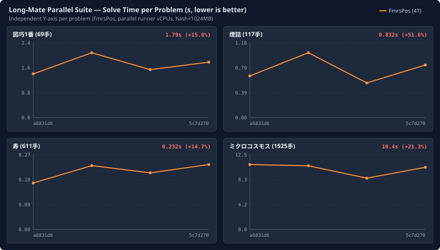
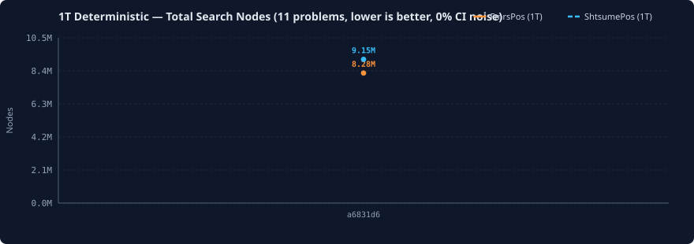

# fmrs::futsuu — Benchmark History

- **Latest Commit**: [`5c7d270`](https://github.com/ogiekako/fmrs/commit/5c7d27038a3eba53ea71fef805b1304a041b91ad) (2026-11-27T08:25:44Z)
- **Recorded Runs**: 4
- **Struct Sizes**: `ShtsumePos` = 680 B, `FmrsPos` = 272 B
- **1T Deterministic (`std`, 11 problems, hash=256MB)**: `FmrsPos` **6.192s** (8,275,216 nodes, 1336.3 kNPS) vs `ShtsumePos` 7.317s (9,145,877 nodes, 1250.0 kNPS) — `SH / FMRS` = **1.18x**
- **Long-Mate Parallel (`long`, 4 problems, 4T, hash=1024MB)**: `FmrsPos` **13.228s** (32,128,617 nodes, 2428.9 kNPS)

## Long-Mate Parallel Trends (Independent Y-Axis per Problem)

## 1T Deterministic Trends (0% Thread-Scheduling Noise)

## Latest Long-Mate Parallel Suite (`5c7d270`, 4T, hash=1024MB)

| Problem | Note | Result | Nodes | Time | kNPS | GC |
| --- | --- | --- | ---: | ---: | ---: | ---: |
| `zuko_01_69` | 69手 (将棋図巧 第1番) | M69 | 4,694,533 (-10.5%) | 1.786s (+15.6%) | 2629.0 | 0 |
| `zuko_99_kemuri_117` | 117手 (将棋図巧 第99番 煙詰) | M117 | 2,071,575 (+15.9%) | 0.832s (+51.6%) | 2489.4 | 0 |
| `zuko_100_kotobuki_611` | 611手 (将棋図巧 第100番 寿) | M611 | 594,195 (-10.8%) | 0.232s (+14.7%) | 2564.9 | 0 |
| `microcosmos_1525` | 1525手 (橋本孝治 ミクロコスモス) | M1545 | 24,768,314 (-1.4%) | 10.378s (+21.3%) | 2386.6 | 0 |

## Latest 1T Deterministic Suite (`5c7d270`, 1T, hash=256MB)

| Problem | Note | SH Res | SH Nodes | SH Time | SH kNPS | FMRS Res | FMRS Nodes | FMRS Time | FMRS kNPS | SH/FMRS |
| --- | --- | --- | ---: | ---: | ---: | --- | ---: | ---: | ---: | ---: |
| `sample_classic_3` | 3手 (shtsume sample) | M3 | 220 | 0.000s (+100.0%) | 1298.4 | M3 | 223 | 0.000s (+33.3%) | 636.9 | 0.50x |
| `yane_2_5` | 5手 (YaneuraOu test) | M5 | 360 | 0.000s (+50.0%) | 1138.0 | M5 | 244 | 0.000s (+50.0%) | 797.2 | 1.00x |
| `lances_11` | 11手 (shtsume wiki / YaneuraOu) | M11 | 1,079 | 0.001s (+50.0%) | 1244.9 | M11 | 1,447 | 0.001s (+25.0%) | 1493.0 | 0.90x |
| `zuko_05_21` | 21手 (将棋図巧 第5番) | M21 | 3,996 | 0.003s (+20.0%) | 1310.4 | M21 | 3,634 | 0.003s (+18.2%) | 1422.2 | 1.15x |
| `yane_5_fg` | 実戦詰 (YaneuraOu Floodgate #5) | M29(余) | 396,519 | 0.332s (+5.8%) | 1194.8 | M39(余) | 173,002 | 0.128s (+13.6%) | 1352.4 | 2.59x |
| `yane_7_fg` | 実戦詰 (YaneuraOu Floodgate #7) | M27(余) | 625,505 | 0.539s (+12.8%) | 1161.2 | M33(余) | 448,736 | 0.345s (+7.4%) | 1299.1 | 1.56x |
| `yane_10_fg_23` | 23手 (YaneuraOu Floodgate #10) | M25 | 810,600 | 0.660s (+15.9%) | 1228.5 | M25 | 1,162,894 | 0.864s (+10.4%) | 1345.7 | 0.76x |
| `yane_13_fg` | 実戦詰 (YaneuraOu Floodgate #13) | M19 | 894,186 | 0.764s (+14.8%) | 1170.2 | M29(余) | 855,623 | 0.661s (+12.4%) | 1293.4 | 1.16x |
| `zuko_01_69` | 69手 (将棋図巧 第1番) | M69 | 4,907,079 | 3.809s (+17.4%) | 1288.2 | M71 | 3,417,974 | 2.495s (+10.6%) | 1369.8 | 1.53x |
| `zuko_99_kemuri_117` | 117手 (将棋図巧 第99番 煙詰) | M117 | 673,985 | 0.534s (+13.2%) | 1262.0 | M117 | 1,801,959 | 1.395s (+10.9%) | 1291.7 | 0.38x |
| `zuko_100_kotobuki_611` | 611手 (将棋図巧 第100番 寿) | M611 | 832,348 | 0.675s (+19.2%) | 1233.9 | M611 | 409,480 | 0.299s (+15.1%) | 1370.1 | 2.26x |

## Recorded Runs

| Commit | Date (UTC) | 1T FMRS Nodes | 1T FMRS Time | 1T SH/FMRS | Long MT Time (T) | Microcosmos | Reasons / Note |
| --- | --- | ---: | ---: | ---: | ---: | ---: | --- |
| [`5c7d270`](https://github.com/ogiekako/fmrs/commit/5c7d27038a3eba53ea71fef805b1304a041b91ad) | 2026-11-27 08:25:44 | 8,275,216 | 6.192s | 1.18x | 13.23s (4T) | 10.38s | fix(futsuu): parallelize solve_unbounded_pn and optimize perfection verification (`1T SH time +15.92%, 1T FMRS time +10.91%, 1T SH kNPS -13.73%, 1T FMRS kNPS -9.84%, Long MT time +21.87%, Long MT kNPS -19.66%`) |
| [`70d03a2`](https://github.com/ogiekako/fmrs/commit/70d03a206fcc736fc91862292ed67635b35df48d) | 2026-11-27 03:58:46 | 8,275,216 | 5.583s | 1.13x | 10.85s (4T) | 8.56s | Add perfection check option and KIF shortcut branch display for futsuu solver (`1T SH time -14.64%, 1T FMRS time -17.41%, 1T SH kNPS +17.16%, 1T FMRS kNPS +21.08%, long:zuko_01_69 verdict changed, Long MT time -22.29%, Long MT kNPS +26.87%`) |
| [`2324f1e`](https://github.com/ogiekako/fmrs/commit/2324f1e0e7b6b40768464b9bad1ec769d1951d42) | 2026-11-27 01:51:02 | 8,275,216 | 6.760s | 1.09x | 13.97s (4T) | 10.62s | feat(futsuu): add solve_unbounded_pn and without_attacker_hand_piece for sound perfection verification (`1T SH time +19.09%, 1T FMRS time +21.05%, 1T SH kNPS -16.03%, 1T FMRS kNPS -17.39%, long:zuko_01_69 verdict changed, long:microcosmos_1525 verdict changed, Long MT time +6.88%, Long MT nodes -24.85%, Long MT kNPS -29.69%`) |
| [`a6831d6`](https://github.com/ogiekako/fmrs/commit/a6831d6ddbc8b4d249f5f27ee721bdb25b5ad1b9) | 2026-11-26 04:45:07 | 8,275,216 | 5.585s | 1.11x | 13.07s (4T) | 10.83s | Rename fmrs_core::shtsume to futsuu and add 1T/long-mate futsuu benchmark suite (`initial baseline`) |
