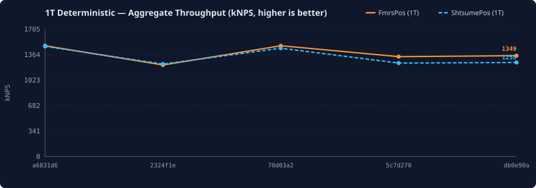

# fmrs::futsuu — Benchmark History

- **Latest Commit**: [`2324f1e`](https://github.com/ogiekako/fmrs/commit/2324f1e0e7b6b40768464b9bad1ec769d1951d42) (2026-11-27T01:51:02Z)
- **Recorded Runs**: 2
- **Struct Sizes**: `ShtsumePos` = 680 B, `FmrsPos` = 272 B
- **1T Deterministic (`std`, 11 problems, hash=256MB)**: `FmrsPos` **6.760s** (8,275,216 nodes, 1224.1 kNPS) vs `ShtsumePos` 7.395s (9,145,877 nodes, 1236.8 kNPS) — `SH / FMRS` = **1.09x**
- **Long-Mate Parallel (`long`, 4 problems, 4T, hash=1024MB)**: `FmrsPos` **13.967s** (33,282,621 nodes, 2382.9 kNPS)

## Long-Mate Parallel Trends (Independent Y-Axis per Problem)

## 1T Deterministic Trends (0% Thread-Scheduling Noise)

## Latest Long-Mate Parallel Suite (`2324f1e`, 4T, hash=1024MB)

| Problem | Note | Result | Nodes | Time | kNPS | GC |
| --- | --- | --- | ---: | ---: | ---: | ---: |
| `zuko_01_69` | 69手 (将棋図巧 第1番) | M71 | 5,278,891 (+10.9%) | 2.089s (+48.4%) | 2527.1 | 0 |
| `zuko_99_kemuri_117` | 117手 (将棋図巧 第99番 煙詰) | M117 | 2,476,501 (+18.6%) | 1.026s (+55.6%) | 2413.8 | 0 |
| `zuko_100_kotobuki_611` | 611手 (将棋図巧 第100番 寿) | M611 | 564,263 (+5.6%) | 0.228s (+37.4%) | 2477.4 | 0 |
| `microcosmos_1525` | 1525手 (橋本孝治 ミクロコスモス) | M1545 | 24,962,966 (-32.4%) | 10.625s (-1.9%) | 2349.5 | 0 |

## Latest 1T Deterministic Suite (`2324f1e`, 1T, hash=256MB)

| Problem | Note | SH Res | SH Nodes | SH Time | SH kNPS | FMRS Res | FMRS Nodes | FMRS Time | FMRS kNPS | SH/FMRS |
| --- | --- | --- | ---: | ---: | ---: | --- | ---: | ---: | ---: | ---: |
| `sample_classic_3` | 3手 (shtsume sample) | M3 | 220 | 0.000s (+0.0%) | 1649.3 | M3 | 223 | 0.000s (+33.3%) | 497.4 | 0.25x |
| `yane_2_5` | 5手 (YaneuraOu test) | M5 | 360 | 0.000s (+50.0%) | 1108.0 | M5 | 244 | 0.001s (+150.0%) | 499.7 | 0.60x |
| `lances_11` | 11手 (shtsume wiki / YaneuraOu) | M11 | 1,079 | 0.001s (+33.3%) | 1340.8 | M11 | 1,447 | 0.001s (+12.5%) | 1551.2 | 0.89x |
| `zuko_05_21` | 21手 (将棋図巧 第5番) | M21 | 3,996 | 0.003s (+20.0%) | 1314.2 | M21 | 3,634 | 0.003s (+27.3%) | 1277.8 | 1.07x |
| `yane_5_fg` | 実戦詰 (YaneuraOu Floodgate #5) | M29(余) | 396,519 | 0.337s (+19.8%) | 1177.4 | M39(余) | 173,002 | 0.139s (+28.8%) | 1246.7 | 2.43x |
| `yane_7_fg` | 実戦詰 (YaneuraOu Floodgate #7) | M27(余) | 625,505 | 0.558s (+20.2%) | 1121.7 | M33(余) | 448,736 | 0.384s (+21.6%) | 1167.8 | 1.45x |
| `yane_10_fg_23` | 23手 (YaneuraOu Floodgate #10) | M25 | 810,600 | 0.676s (+19.9%) | 1198.7 | M25 | 1,162,894 | 0.941s (+21.5%) | 1236.2 | 0.72x |
| `yane_13_fg` | 実戦詰 (YaneuraOu Floodgate #13) | M19 | 894,186 | 0.767s (+19.0%) | 1166.2 | M29(余) | 855,623 | 0.708s (+22.6%) | 1208.5 | 1.08x |
| `zuko_01_69` | 69手 (将棋図巧 第1番) | M69 | 4,907,079 | 3.831s (+19.6%) | 1281.0 | M71 | 3,417,974 | 2.712s (+21.9%) | 1260.5 | 1.41x |
| `zuko_99_kemuri_117` | 117手 (将棋図巧 第99番 煙詰) | M117 | 673,985 | 0.550s (+17.8%) | 1224.2 | M117 | 1,801,959 | 1.545s (+18.0%) | 1166.1 | 0.36x |
| `zuko_100_kotobuki_611` | 611手 (将棋図巧 第100番 寿) | M611 | 832,348 | 0.672s (+15.2%) | 1238.5 | M611 | 409,480 | 0.327s (+20.5%) | 1254.0 | 2.06x |

## Recorded Runs

| Commit | Date (UTC) | 1T FMRS Nodes | 1T FMRS Time | 1T SH/FMRS | Long MT Time (T) | Microcosmos | Reasons / Note |
| --- | --- | ---: | ---: | ---: | ---: | ---: | --- |
| [`2324f1e`](https://github.com/ogiekako/fmrs/commit/2324f1e0e7b6b40768464b9bad1ec769d1951d42) | 2026-11-27 01:51:02 | 8,275,216 | 6.760s | 1.09x | 13.97s (4T) | 10.62s | feat(futsuu): add solve_unbounded_pn and without_attacker_hand_piece for sound perfection verification (`1T SH time +19.09%, 1T FMRS time +21.05%, 1T SH kNPS -16.03%, 1T FMRS kNPS -17.39%, long:zuko_01_69 verdict changed, long:microcosmos_1525 verdict changed, Long MT time +6.88%, Long MT nodes -24.85%, Long MT kNPS -29.69%`) |
| [`a6831d6`](https://github.com/ogiekako/fmrs/commit/a6831d6ddbc8b4d249f5f27ee721bdb25b5ad1b9) | 2026-11-26 04:45:07 | 8,275,216 | 5.585s | 1.11x | 13.07s (4T) | 10.83s | Rename fmrs_core::shtsume to futsuu and add 1T/long-mate futsuu benchmark suite (`initial baseline`) |
