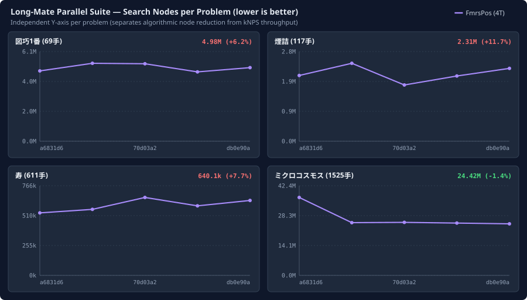

# fmrs::futsuu — Benchmark History

- **Latest Commit**: [`a6831d6`](https://github.com/ogiekako/fmrs/commit/a6831d6ddbc8b4d249f5f27ee721bdb25b5ad1b9) (2026-11-26T04:45:07Z)
- **Recorded Runs**: 1
- **Struct Sizes**: `ShtsumePos` = 680 B, `FmrsPos` = 272 B
- **1T Deterministic (`std`, 11 problems, hash=256MB)**: `FmrsPos` **5.585s** (8,275,216 nodes, 1481.8 kNPS) vs `ShtsumePos` 6.210s (9,145,877 nodes, 1472.9 kNPS) — `SH / FMRS` = **1.11x**
- **Long-Mate Parallel (`long`, 4 problems, 4T, hash=1024MB)**: `FmrsPos` **13.068s** (44,290,710 nodes, 3389.3 kNPS)

## Long-Mate Parallel Trends (Independent Y-Axis per Problem)

## 1T Deterministic Trends (0% Thread-Scheduling Noise)

## Latest Long-Mate Parallel Suite (`a6831d6`, 4T, hash=1024MB)

| Problem | Note | Result | Nodes | Time | kNPS | GC |
| --- | --- | --- | ---: | ---: | ---: | ---: |
| `zuko_01_69` | 69手 (将棋図巧 第1番) | M69 | 4,761,528 | 1.408s | 3382.1 | 0 |
| `zuko_99_kemuri_117` | 117手 (将棋図巧 第99番 煙詰) | M117 | 2,088,241 | 0.659s | 3166.4 | 0 |
| `zuko_100_kotobuki_611` | 611手 (将棋図巧 第100番 寿) | M611 | 534,126 | 0.166s | 3221.9 | 0 |
| `microcosmos_1525` | 1525手 (橋本孝治 ミクロコスモス) | M1549 | 36,906,815 | 10.835s | 3406.4 | 0 |

## Latest 1T Deterministic Suite (`a6831d6`, 1T, hash=256MB)

| Problem | Note | SH Res | SH Nodes | SH Time | SH kNPS | FMRS Res | FMRS Nodes | FMRS Time | FMRS kNPS | SH/FMRS |
| --- | --- | --- | ---: | ---: | ---: | --- | ---: | ---: | ---: | ---: |
| `sample_classic_3` | 3手 (shtsume sample) | M3 | 220 | 0.000s | 1697.6 | M3 | 223 | 0.000s | 862.6 | 0.33x |
| `yane_2_5` | 5手 (YaneuraOu test) | M5 | 360 | 0.000s | 1453.5 | M5 | 244 | 0.000s | 1001.7 | 1.00x |
| `lances_11` | 11手 (shtsume wiki / YaneuraOu) | M11 | 1,079 | 0.001s | 1824.3 | M11 | 1,447 | 0.001s | 1822.0 | 0.75x |
| `zuko_05_21` | 21手 (将棋図巧 第5番) | M21 | 3,996 | 0.003s | 1622.2 | M21 | 3,634 | 0.002s | 1644.9 | 1.14x |
| `yane_5_fg` | 実戦詰 (YaneuraOu Floodgate #5) | M29(余) | 396,519 | 0.281s | 1410.1 | M39(余) | 173,002 | 0.108s | 1605.3 | 2.61x |
| `yane_7_fg` | 実戦詰 (YaneuraOu Floodgate #7) | M27(余) | 625,505 | 0.464s | 1348.7 | M33(余) | 448,736 | 0.316s | 1419.8 | 1.47x |
| `yane_10_fg_23` | 23手 (YaneuraOu Floodgate #10) | M25 | 810,600 | 0.564s | 1437.1 | M25 | 1,162,894 | 0.774s | 1501.8 | 0.73x |
| `yane_13_fg` | 実戦詰 (YaneuraOu Floodgate #13) | M19 | 894,186 | 0.644s | 1388.1 | M29(余) | 855,623 | 0.578s | 1481.0 | 1.12x |
| `zuko_01_69` | 69手 (将棋図巧 第1番) | M69 | 4,907,079 | 3.203s | 1532.2 | M71 | 3,417,974 | 2.225s | 1536.2 | 1.44x |
| `zuko_99_kemuri_117` | 117手 (将棋図巧 第99番 煙詰) | M117 | 673,985 | 0.467s | 1442.6 | M117 | 1,801,959 | 1.309s | 1376.3 | 0.36x |
| `zuko_100_kotobuki_611` | 611手 (将棋図巧 第100番 寿) | M611 | 832,348 | 0.583s | 1427.3 | M611 | 409,480 | 0.271s | 1511.4 | 2.15x |

## Recorded Runs

| Commit | Date (UTC) | 1T FMRS Nodes | 1T FMRS Time | 1T SH/FMRS | Long MT Time (T) | Microcosmos | Reasons / Note |
| --- | --- | ---: | ---: | ---: | ---: | ---: | --- |
| [`a6831d6`](https://github.com/ogiekako/fmrs/commit/a6831d6ddbc8b4d249f5f27ee721bdb25b5ad1b9) | 2026-11-26 04:45:07 | 8,275,216 | 5.585s | 1.11x | 13.07s (4T) | 10.83s | Rename fmrs_core::shtsume to futsuu and add 1T/long-mate futsuu benchmark suite (`initial baseline`) |
