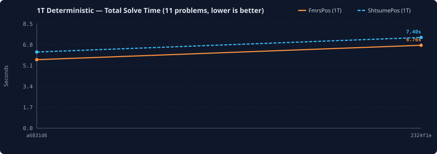
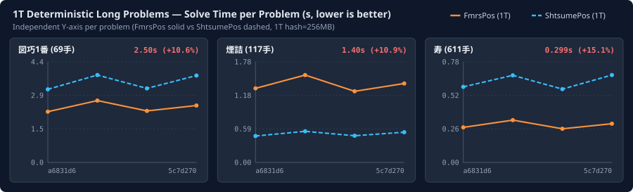

# fmrs::futsuu — Benchmark History

- **Latest Commit**: [`db0e90a`](https://github.com/ogiekako/fmrs/commit/db0e90a6aef1ce633a1aeabcca849037e4345ee4) (2026-11-27T08:50:49Z)
- **Recorded Runs**: 5
- **Struct Sizes**: `ShtsumePos` = 680 B, `FmrsPos` = 272 B
- **1T Deterministic (`std`, 11 problems, hash=256MB)**: `FmrsPos` **6.466s** (8,721,230 nodes, 1348.8 kNPS) vs `ShtsumePos` 7.320s (9,210,231 nodes, 1258.2 kNPS) — `SH / FMRS` = **1.13x**
- **Long-Mate Parallel (`long`, 4 problems, 4T, hash=1024MB)**: `FmrsPos` **12.842s** (32,361,887 nodes, 2520.0 kNPS)

## Long-Mate Parallel Trends (Independent Y-Axis per Problem)

## 1T Deterministic Trends (0% Thread-Scheduling Noise)

## Latest Long-Mate Parallel Suite (`db0e90a`, 4T, hash=1024MB)

| Problem | Note | Result | Nodes | Time | kNPS | GC |
| --- | --- | --- | ---: | ---: | ---: | ---: |
| `zuko_01_69` | 69手 (将棋図巧 第1番) | M69 | 4,984,884 (+6.2%) | 1.835s (+2.8%) | 2715.8 | 0 |
| `zuko_99_kemuri_117` | 117手 (将棋図巧 第99番 煙詰) | M117 | 2,312,834 (+11.7%) | 0.922s (+10.8%) | 2509.0 | 0 |
| `zuko_100_kotobuki_611` | 611手 (将棋図巧 第100番 寿) | M611 | 640,123 (+7.7%) | 0.248s (+7.0%) | 2583.1 | 0 |
| `microcosmos_1525` | 1525手 (橋本孝治 ミクロコスモス) | M1529 | 24,424,046 (-1.4%) | 9.837s (-5.2%) | 2483.0 | 0 |

## Latest 1T Deterministic Suite (`db0e90a`, 1T, hash=256MB)

| Problem | Note | SH Res | SH Nodes | SH Time | SH kNPS | FMRS Res | FMRS Nodes | FMRS Time | FMRS kNPS | SH/FMRS |
| --- | --- | --- | ---: | ---: | ---: | --- | ---: | ---: | ---: | ---: |
| `sample_classic_3` | 3手 (shtsume sample) | M3 | 254 | 0.000s (+0.0%) | 1573.9 | M3 | 223 | 0.000s (-25.0%) | 725.6 | 0.67x |
| `yane_2_5` | 5手 (YaneuraOu test) | M5 | 376 | 0.000s (+0.0%) | 1377.5 | M5 | 244 | 0.000s (+0.0%) | 821.0 | 1.00x |
| `lances_11` | 11手 (shtsume wiki / YaneuraOu) | M11 | 1,079 | 0.001s (-22.2%) | 1636.2 | M11 | 1,447 | 0.001s (-10.0%) | 1596.0 | 0.78x |
| `zuko_05_21` | 21手 (将棋図巧 第5番) | M21 | 3,996 | 0.003s (+0.0%) | 1329.0 | M21 | 3,634 | 0.003s (-3.9%) | 1444.8 | 1.20x |
| `yane_5_fg` | 実戦詰 (YaneuraOu Floodgate #5) | M29(余) | 396,519 | 0.335s (+0.8%) | 1184.9 | M39(余) | 173,002 | 0.132s (+2.9%) | 1314.3 | 2.54x |
| `yane_7_fg` | 実戦詰 (YaneuraOu Floodgate #7) | M27(余) | 625,505 | 0.545s (+1.2%) | 1147.0 | M33(余) | 448,823 | 0.353s (+2.1%) | 1272.2 | 1.55x |
| `yane_10_fg_23` | 23手 (YaneuraOu Floodgate #10) | M25 | 810,600 | 0.661s (+0.1%) | 1227.0 | M25 | 1,162,769 | 0.860s (-0.5%) | 1351.9 | 0.77x |
| `yane_13_fg` | 実戦詰 (YaneuraOu Floodgate #13) | M19 | 894,186 | 0.763s (-0.2%) | 1172.4 | M29(余) | 855,664 | 0.658s (-0.5%) | 1299.8 | 1.16x |
| `zuko_01_69` | 69手 (将棋図巧 第1番) | M71 | 4,971,383 | 3.780s (-0.8%) | 1315.3 | M71 | 4,001,947 | 2.873s (+15.1%) | 1393.2 | 1.32x |
| `zuko_99_kemuri_117` | 117手 (将棋図巧 第99番 煙詰) | M117 | 673,985 | 0.549s (+2.8%) | 1227.5 | M119 | 1,664,848 | 1.288s (-7.7%) | 1292.8 | 0.43x |
| `zuko_100_kotobuki_611` | 611手 (将棋図巧 第100番 寿) | M611 | 832,348 | 0.684s (+1.4%) | 1216.8 | M611 | 408,629 | 0.298s (-0.1%) | 1369.0 | 2.29x |

## Recorded Runs

| Commit | Date (UTC) | 1T FMRS Nodes | 1T FMRS Time | 1T SH/FMRS | Long MT Time (T) | Microcosmos | Reasons / Note |
| --- | --- | ---: | ---: | ---: | ---: | ---: | --- |
| [`db0e90a`](https://github.com/ogiekako/fmrs/commit/db0e90a6aef1ce633a1aeabcca849037e4345ee4) | 2026-11-27 08:50:49 | 8,721,230 | 6.466s | 1.13x | 12.84s (4T) | 9.84s | Cherry-pick validated futsuu soundness fixes and safety guards from tsumegen/fmrs (`std:zuko_01_69/shtsume verdict changed, std:zuko_99_kemuri_117/fmrs verdict changed, 1T SH nodes +0.70%, 1T FMRS nodes +5.39%, 1T FMRS time +4.41%, long:microcosmos_1525 verdict changed`) |
| [`5c7d270`](https://github.com/ogiekako/fmrs/commit/5c7d27038a3eba53ea71fef805b1304a041b91ad) | 2026-11-27 08:25:44 | 8,275,216 | 6.192s | 1.18x | 13.23s (4T) | 10.38s | fix(futsuu): parallelize solve_unbounded_pn and optimize perfection verification (`1T SH time +15.92%, 1T FMRS time +10.91%, 1T SH kNPS -13.73%, 1T FMRS kNPS -9.84%, Long MT time +21.87%, Long MT kNPS -19.66%`) |
| [`70d03a2`](https://github.com/ogiekako/fmrs/commit/70d03a206fcc736fc91862292ed67635b35df48d) | 2026-11-27 03:58:46 | 8,275,216 | 5.583s | 1.13x | 10.85s (4T) | 8.56s | Add perfection check option and KIF shortcut branch display for futsuu solver (`1T SH time -14.64%, 1T FMRS time -17.41%, 1T SH kNPS +17.16%, 1T FMRS kNPS +21.08%, long:zuko_01_69 verdict changed, Long MT time -22.29%, Long MT kNPS +26.87%`) |
| [`2324f1e`](https://github.com/ogiekako/fmrs/commit/2324f1e0e7b6b40768464b9bad1ec769d1951d42) | 2026-11-27 01:51:02 | 8,275,216 | 6.760s | 1.09x | 13.97s (4T) | 10.62s | feat(futsuu): add solve_unbounded_pn and without_attacker_hand_piece for sound perfection verification (`1T SH time +19.09%, 1T FMRS time +21.05%, 1T SH kNPS -16.03%, 1T FMRS kNPS -17.39%, long:zuko_01_69 verdict changed, long:microcosmos_1525 verdict changed, Long MT time +6.88%, Long MT nodes -24.85%, Long MT kNPS -29.69%`) |
| [`a6831d6`](https://github.com/ogiekako/fmrs/commit/a6831d6ddbc8b4d249f5f27ee721bdb25b5ad1b9) | 2026-11-26 04:45:07 | 8,275,216 | 5.585s | 1.11x | 13.07s (4T) | 10.83s | Rename fmrs_core::shtsume to futsuu and add 1T/long-mate futsuu benchmark suite (`initial baseline`) |
